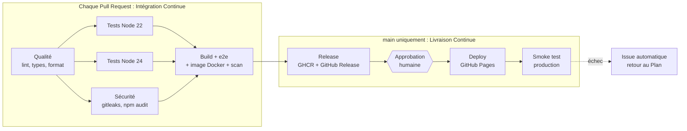

# M354 · Planning des exposés : démo DevOps

Application React volontairement simple, qui sert de support à l'exposé **« Culture DevOps et chaîne CI/CD »** (M354 Virtualisation et Cloud Computing, FST Errachidia, 2026/2027).

L'application affiche le planning des exposés du module, avec une recherche et un filtre par date. **Le sujet n'est pas l'application : c'est la boucle DevOps qu'elle traverse**, de l'idée jusqu'à la production, avec un outil réel à chaque phase.


## Une phase, un outil

| #   | Phase   | Outil dans ce projet                                                           | Où le voir                                  |
| --- | ------- | ------------------------------------------------------------------------------ | ------------------------------------------- |
| 1   | Plan    | GitHub Issues + GitHub Projects (tableau Kanban)                               | `.github/ISSUE_TEMPLATE/`, onglet Projects  |
| 2   | Code    | Git, VS Code, Pull Request + revue                                             | `.github/pull_request_template.md`          |
| 3   | Build   | Vite (build React) + Docker (image nginx non-root)                             | `vite.config.ts`, `Dockerfile`, job `build` |
| 4   | Test    | ESLint, TypeScript, Prettier, Vitest, Playwright, gitleaks, npm audit, Grype   | jobs `quality`, `test`, `security`, `build` |
| 5   | Release | GitHub Releases (notes + `dist.zip`) + image sur GHCR                          | job `release`, onglets Releases et Packages |
| 6   | Deploy  | GitHub Pages, derrière une approbation humaine                                 | job `deploy`, environnement `github-pages`  |
| 7   | Operate | Smoke test en production + rollback en un clic                                 | job `smoke`, workflow `Rollback`            |
| 8   | Monitor | Sonde planifiée (disponibilité, temps de réponse, version) + issue automatique | workflow `Monitor`, job `feedback`          |

Le détail de chaque phase : **[docs/PHASES.md](docs/PHASES.md)**.

## Le pipeline



## Démarrage rapide

Prérequis : Node.js 22 ou plus.

```bash
npm ci              # installe les dépendances
npm run dev         # serveur de développement : http://localhost:5173
npm run lint        # ESLint
npm run test:cov    # tests unitaires + couverture (seuil 80 %)
npm run build       # build de production dans dist/
npm run e2e         # tests end-to-end Playwright sur le build
```

Avec Docker :

```bash
npm run build
docker build -t m354-web .
docker run --rm -p 8080:8080 m354-web    # http://localhost:8080
```

## Documentation

| Fichier                                              | Pour qui, pour quoi                                                   |
| ---------------------------------------------------- | --------------------------------------------------------------------- |
| [docs/PHASES.md](docs/PHASES.md)                     | Description détaillée des 8 phases et de ce que fait chaque fichier   |
| [docs/TP.md](docs/TP.md)                             | TP d'1 h 30 pour la classe : construire sa propre chaîne CI/CD        |
| [docs/SETUP.md](docs/SETUP.md)                       | Mise en place du dépôt GitHub (une seule fois, environ 30 minutes)    |
| [docs/TOURNAGE.md](docs/TOURNAGE.md)                 | Guide d'enregistrement de la vidéo de démo, plan par plan             |
| [docs/COMMENTAIRE_LIVE.md](docs/COMMENTAIRE_LIVE.md) | Commentaire à dire en direct pendant la vidéo, calé sur ses chapitres |

## Structure

```
.github/
  workflows/ci-cd.yml      pipeline principal (8 jobs)
  workflows/rollback.yml   retour arrière vers une version publiée
  workflows/monitor.yml    sonde de production toutes les 30 min
  ISSUE_TEMPLATE/          modèles d'issue (fonctionnalité, bug)
  dependabot.yml           mises à jour automatiques des dépendances
demo/                      les deux changements utilisés dans la vidéo (fonctionnalité, bug)
docker/nginx.conf          configuration du serveur de l'image
e2e/smoke.spec.ts          test end-to-end (local et production)
scripts/                   version.json, attente de la mise en ligne
src/                       l'application React et ses tests
.gitlab-ci.yml             le même pipeline en GitLab CI, pour comparer
```
